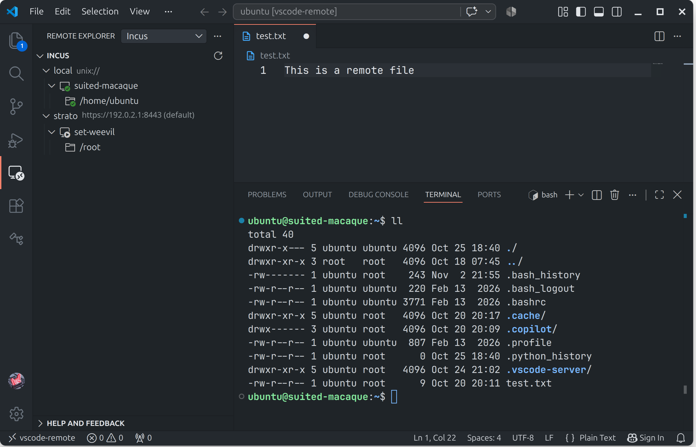
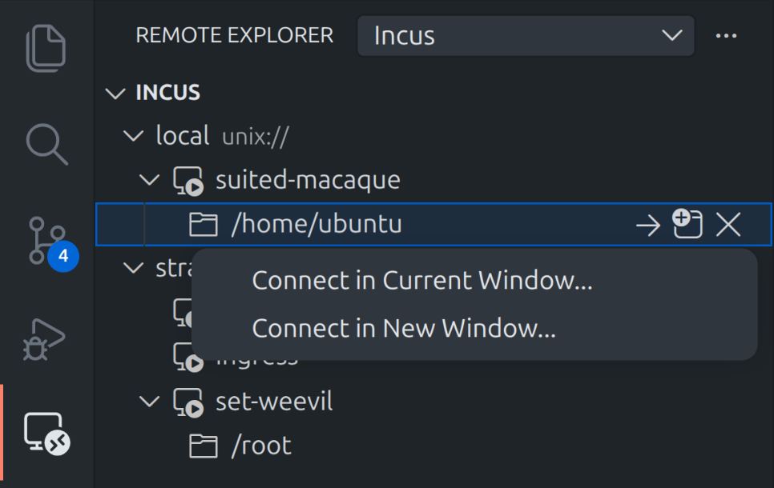

# Remote - Incus

[](https://github.com/dodbrian/vscode-remote-incus/actions/workflows/offline-ci.yml)

Connect VS Code to [Incus](https://github.com/lxc/incus) system containers through
Remote Explorer, using your existing Incus client configuration. No SSH server
is required inside the container.

🚨 **Beta:** This extension is under active development. Expect bugs and rough edges.

This is an independent project, not affiliated with or endorsed by the Incus
project or Linux Containers.



## How it works

Remote - Incus uses your existing Incus client configuration to discover and
connect to containers on local or remote servers. It runs VS Code Server inside the container,
then connects through `incus exec`. No SSH server or externally exposed container
ports are required.

## Requirements

- **Editor:** VS Code or a compatible editor, such as VSCodium, with support for
  the required proposed APIs and compatibility with VS Code 1.140.0 or later.
- **Incus:** the [Incus CLI](https://linuxcontainers.org/incus/docs/main/installing/)
  available in the editor's PATH, with access to a local or remote Incus server.
- **Client platform:** Linux and macOS have been verified. An official Incus CLI
  is available for Windows, but the extension has not yet been verified there.
- **Container:** a Linux system container with the tools and runtime libraries
  needed by VS Code Server. Ubuntu, Debian and CentOS may require additional
  packages, especially on minimal images.

Inside the container, setup requires `/bin/sh`, `tar`, `gzip` and standard core
utilities, including `sha256sum` and `nohup`, available in the selected user's
PATH. Bash is not required. Setup reports missing prerequisites; it does not
install system packages automatically. Minimal Alpine x64 images additionally
need `libstdc++` and `libgcc`. The rescue terminal requires util-linux `script`.

## Installation

1. Download the extension's VSIX from
   [Open VSX](https://open-vsx.org/extension/dodbrian/remote-incus).
2. Run **Preferences: Configure Runtime Arguments** from the Command Palette.
   Add the following entry to `argv.json`, preserving any existing settings:

   ```json
   {
     "enable-proposed-api": ["dodbrian.remote-incus"]
   }
   ```

3. Open the Extensions view, select **… → Install from VSIX…**, and choose the
   downloaded file. Alternatively, install it from the command line:

   ```sh
   code --install-extension /path/to/downloaded-extension.vsix
   ```

   Replace the path with your downloaded VSIX file. For VSCodium, use `codium`
   instead of `code`.

4. Restart the editor.

To build the VSIX locally, see [Development](https://github.com/dodbrian/vscode-remote-incus/blob/main/README.md#development).

## Incus setup

Configure the Incus CLI to access your server:

- **Local server:** ensure Incus is running and your user has permission to
  access it. For a new server, run `incus admin init`. See the official
  [server initialization guide](https://linuxcontainers.org/incus/docs/main/howto/initialize/)
  for configuration details.
- **Remote server:** add it with `incus remote add`, following your server
  administrator's instructions. See the official
  [remote server guide](https://linuxcontainers.org/incus/docs/main/remotes/)
  for connection and authentication details.

Check access in a terminal:

```sh
incus remote list
incus list <remote>:
```

Replace `<remote>` with your configured remote name, such as `local`.
For a complete introduction, see [First steps with Incus](https://linuxcontainers.org/incus/docs/main/tutorial/first_steps/).

## Connect to a container

1. Open the Command Palette and run **Remote - Incus: Show Incus**. Alternatively,
   open **Remote Explorer** and select **Incus** from the target dropdown.
2. Expand your server to see its containers.
3. Right-click a container and choose **Connect in Current Window…** or
   **Connect in New Window…**.

Once connected, open a folder and work with files, terminals and extensions in
the remote environment.



## Server installation

On the first connection, the extension downloads and installs VS Code Server
inside the container. Existing matching installations are reused.

By default, it tries downloading inside the container, then falls back to
downloading on your computer and transferring through Incus.

| `remote-incus.downloadStrategy` | Behavior                                                                                             |
| ------------------------------- | ---------------------------------------------------------------------------------------------------- |
| `auto` (default)                | Try the container first, then fall back to client transfer.                                          |
| `client`                        | Download on your computer and transfer through Incus. Useful for containers without internet access. |
| `container`                     | Download inside the container, with no fallback. Requires `curl` and outbound HTTPS.                 |

For custom mirrors, set `remote-incus.downloadUrlTemplate` and use `auto` or
`client`; custom mirrors use client transfer directly.

## Development

Install dependencies, run the checks and build the extension:

```sh
npm ci
npm test
npm run package
```

The packaged extension is written to `remote-incus.vsix`.

See the [contributor guide](https://github.com/dodbrian/vscode-remote-incus/blob/main/docs/CONTRIBUTING.md) for development setup and quality
rules, the [testing guide](https://github.com/dodbrian/vscode-remote-incus/blob/main/docs/tests/README.md) for additional checks, the
[release guide](https://github.com/dodbrian/vscode-remote-incus/blob/main/docs/RELEASING.md) for publication and the
[changelog](https://github.com/dodbrian/vscode-remote-incus/blob/main/CHANGELOG.md) for release history.

## Troubleshooting

### The Incus view is missing

Run **Remote - Incus: Show Incus** from the Command Palette. If the view is still
unavailable, confirm that the extension is enabled and the proposed API is
configured as described in [Installation](https://github.com/dodbrian/vscode-remote-incus/blob/main/README.md#installation), then restart the editor.

### A server is unavailable

Check access in a terminal with `incus list <remote>:`, replacing `<remote>` with
your configured remote name. After fixing access, select **Try again** on the
server node or use the view's **Refresh** button.

### An IPv4 service is unreachable through port forwarding

If an IPv4-only service is unreachable through ordinary forwarding in an
IPv6-only container, right-click its row in the **Ports** view and select
**Forward over IPv4**.

The action requires an existing port row. If it creates a second forward, stop
the original when it is no longer needed.

## Feedback and bug reports

Report bugs and suggest improvements through
[GitHub Issues](https://github.com/dodbrian/vscode-remote-incus/issues).
For bug reports, include your editor name and version, client operating system,
Incus version, container distribution and steps to reproduce the problem.
Remove credentials and private infrastructure details from any logs you share.

## Related projects

- [Canonical Workshop](https://ubuntu.com/workshop/docs/how-to/develop-with-workshops/connect-vscode/)
  provides LXD development environments with VS Code access through Remote-SSH.
- [ssh2incus](https://github.com/mobydeck/ssh2incus) provides an SSH gateway to
  Incus instances without requiring an SSH server inside each instance.

## License

Remote - Incus is licensed under the [MIT License](https://github.com/dodbrian/vscode-remote-incus/blob/main/LICENSE).

Bundled tree SVGs are by Microsoft and contributors, licensed under
[CC BY 4.0](https://creativecommons.org/licenses/by/4.0/).
See the [third-party notices](https://github.com/dodbrian/vscode-remote-incus/blob/main/docs/ThirdPartyNotices.md)
for source and license details. These notices are also included in the extension package.

## Documentation

See the [documentation index](https://github.com/dodbrian/vscode-remote-incus/blob/main/docs/README.md) for architecture, contributor guides,
testing and project history.
